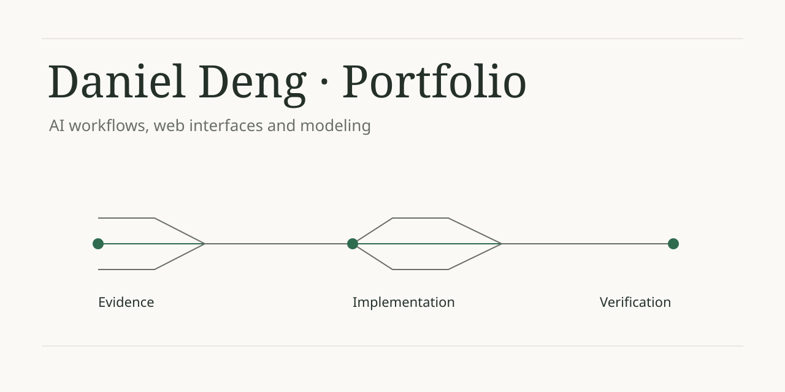

<picture>
  <source media="(prefers-color-scheme: dark)" srcset="assets/portfolio-cover-dark.svg" />
  <source media="(prefers-color-scheme: light)" srcset="assets/portfolio-cover-light.svg" />
  
</picture>

# Portfolio

**[Open the project gallery](https://daniel-24-life.github.io/portfolio/)** · [中文](README.zh.md) · [GitHub profile](https://github.com/Daniel-24-life)

Agent engineering, web workbenches, and modeling projects. Directory release [v3.2](CHANGELOG.md).

Search by name or topic. Open the project's demonstration, source repository, and test run from the same card.

## Public project shortcuts

<!-- gallery:start -->

- **[Trade Desk Copilot](https://github.com/Daniel-24-life/trade-desk-copilot)** · [Demo recording](https://github.com/Daniel-24-life/trade-desk-copilot#demo)
- **[CosmoPilot V4.0](https://github.com/Daniel-24-life/cosmopilot-v4)** · [Demo recording](https://github.com/Daniel-24-life/cosmopilot-v4#demo)
- **[Buyer Research Agent](https://github.com/Daniel-24-life/buyer-research-agent)** · [Demo recording](https://github.com/Daniel-24-life/buyer-research-agent#demo)
- **[Logistics Workbench](https://github.com/Daniel-24-life/logistics-workbench)** · [Live demo](https://daniel-24-life.github.io/logistics-workbench/)
- **[BTC Agent Governance](https://github.com/Daniel-24-life/btc-agent-governance)** · [Live demo](https://daniel-24-life.github.io/btc-agent-governance/)
- **[AgentPlatform Case Study](https://github.com/Daniel-24-life/agentplatform-case-study)** · [Live case study](https://daniel-24-life.github.io/agentplatform-case-study/)
- **[Production Workflow Mindmap](https://github.com/Daniel-24-life/production-workflow-mindmap)** · [Live demo](https://daniel-24-life.github.io/production-workflow-mindmap/)
- **[Localization Integrity Lab](https://github.com/Daniel-24-life/localization-integrity-lab)** · [Result chart](https://github.com/Daniel-24-life/localization-integrity-lab#demo)
- **[Sports Franchise Optimization](https://github.com/Daniel-24-life/sports-franchise-optimization)** · [Result chart](https://github.com/Daniel-24-life/sports-franchise-optimization#demo)
- **[Fishery Dynamics Model](https://github.com/Daniel-24-life/fishery-dynamics-model)** · [Result chart](https://github.com/Daniel-24-life/fishery-dynamics-model#demo)

<!-- gallery:end -->

<details>
<summary>Research notes, reference packages, and release notes</summary>

<!-- portfolio:start -->

## Project directory

### Business products

| Project | Focus | State |
| --- | --- | --- |
| [CosmoPilot V4.0](https://github.com/Daniel-24-life/cosmopilot-v4/blob/main/README.md) | Consumer-service evidence, protected drafts and local feedback in one workspace. | Offline public reference of V4.0 mechanisms |
| [Hangxu Logistics Workbench](https://github.com/Daniel-24-life/logistics-workbench/blob/main/README.md) | A synthetic exception-to-task workflow with role views. | Offline product demo |
| [Buyer Research Agent](https://github.com/Daniel-24-life/buyer-research-agent/blob/main/README.md) | Demand evidence, unknowns and a durable local queue. | Offline reference |
| [Trade Desk Copilot](https://github.com/Daniel-24-life/trade-desk-copilot/blob/main/README.md) | Edge-docked HUD workbench: session isolation, interactive DST slot tracking, RAG catalog grounding, and 1080x1080 quotation cards. | Offline product demo |
| [Creator Discovery Pipeline](showcases/creator-discovery-pipeline/) | Normalize public signals into a reviewed handoff table. | Synthetic case and skeleton |
| [Production Workflow Mindmap](https://github.com/Daniel-24-life/production-workflow-mindmap) | Inspect production inputs, review gates, and handoffs. | Synthetic web demo |

### Agent engineering

| Project | Focus | State |
| --- | --- | --- |
| [BTC Agent Governance](https://github.com/Daniel-24-life/btc-agent-governance/blob/main/README.md) | Four synthetic scenarios with bounded evidence and no trading authority. | Research governance skeleton |
| [Mailbox Governance Agent](showcases/mailbox-agent-system/) | Synthetic action review without mailbox connectivity or delivery. | Local policy demo |
| [Daily Brief Agent](showcases/daily-brief-agent/) | Source classes, citation checks and uncertain-claim review. | Synthetic case and skeleton |

### Research and content

| Project | Focus | State |
| --- | --- | --- |
| [Localization Integrity Lab](https://github.com/Daniel-24-life/localization-integrity-lab/blob/main/README.md) | Kinematic ODEs, Gramian observability, absorbing boundary PDEs, and colored-noise filtering. | Reproducible research benchmark |
| [WTI Market Research Case](showcases/wti-market-research/) | Timing-aware public-series research and frozen-test audits. | Sanitized research case |
| [AIGC Video Production Pipeline](showcases/aigc-video-production-pipeline/) | Shot planning, asset review and delivery checks. | Public workflow and reconstructed sample |
| [Sports Franchise Optimization](https://github.com/Daniel-24-life/sports-franchise-optimization) | Optimize a fictional roster under budget, role, and risk constraints. | Synthetic modeling case |
| [Fishery Dynamics Model](https://github.com/Daniel-24-life/fishery-dynamics-model) | Explore population dynamics under harvest and profit assumptions. | Course model and reproduction |

### Methods and learning

| Project | Focus | State |
| --- | --- | --- |
| [AI Skill Routing Playbook](shelves/skills/ai-skill-routing-playbook/) | Task-first selection with explicit workflow boundaries. | Public playbook |
| [AI Workflow Learning System](shelves/understanding/ai-workflow-learning-system/) | Turn reading and checked practice into reusable working rules. | Methods and handbook |

### Engineering retrospectives

| Project | Focus | State |
| --- | --- | --- |
| [AgentPlatform Case Study](https://github.com/Daniel-24-life/agentplatform-case-study/blob/main/README.md) | Controlled single-task execution and lessons from a discontinued product. | Discontinued |

## Recent releases

- 2026-11-04 · [Trade Desk Copilot](https://github.com/Daniel-24-life/trade-desk-copilot/blob/main/README.md) · v1.0 — Initial open-source release: dual-mode offline simulation, interactive DST state machine, and host-aware formatting.
- 2026-11-04 · [Localization Integrity Lab](https://github.com/Daniel-24-life/localization-integrity-lab/blob/main/README.md) · v1.0 — Initial research release: 144-condition benchmark, absorbing boundary PDE solvers, and 116 tests.
- 2026-10-25 · [CosmoPilot V4.0](https://github.com/Daniel-24-life/cosmopilot-v4/blob/main/README.md) · V4.0 public reference — Consumer-service workspace, AI Coding notes and synthetic reference demo.

## Add the next project

[Publishing guide and templates (Chinese)](docs/ADD_PROJECT.md)

<!-- portfolio:end -->

</details>

## Verification and boundaries

Python 3.11+:

```sh
python -m pip install -r requirements-dev.txt
python scripts/verify_public_packages.py
```

This repository verifies its registry, generated content, relative links,
public text and four retained code packages. Independent projects run their own
behavior tests and CI. Deep documentation retains its original language.

See the [registry](catalog/projects.json), [code shelf](shelves/code/),
[design notes](docs/DESIGN_NOTES.md) and [publication guide](docs/ADD_PROJECT.md).
Credentials, real contacts, transactions, private materials and production
execution chains are excluded. AgentPlatform remains a discontinued case study.

## Preview the gallery locally

Run the following commands and open the gallery at `http://127.0.0.1:8000/gallery/`.

```sh
python scripts/build_gallery.py
python -m http.server 8000 --bind 127.0.0.1 --directory build
```
