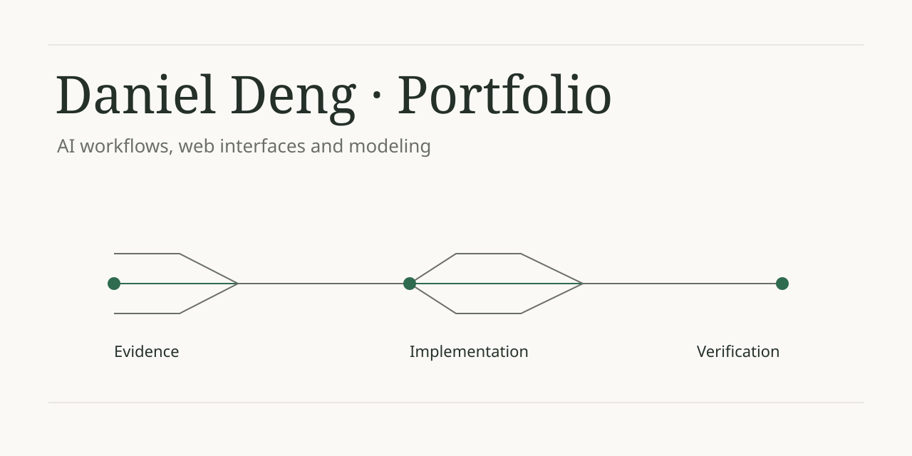

<picture>
  <source media="(prefers-color-scheme: dark)" srcset="assets/portfolio-cover-dark.svg" />
  <source media="(prefers-color-scheme: light)" srcset="assets/portfolio-cover-light.svg" />
  
</picture>

# 作品目录

[English](README.md) · [个人主页](https://github.com/Daniel-24-life)

公开的 Agent 工程、Web 工作台和建模项目。目录版本见 [v3.2](CHANGELOG.md)。

## 公开项目

| 项目 | 实现 | 演示 |
| --- | --- | --- |
| [外贸询盘工作台](https://github.com/Daniel-24-life/trade-desk-copilot) | 把分散在多轮对话中的需求整理成可检查的回复草稿与报价卡。 | [查看演示](https://github.com/Daniel-24-life/trade-desk-copilot#demo) |
| [CosmoPilot 消费者服务台](https://github.com/Daniel-24-life/cosmopilot-v4) | 在同一个客服工作台查看当时可见的证据、编辑草稿和登记复核决定。 | [查看演示](https://github.com/Daniel-24-life/cosmopilot-v4#demo) |
| [买家研究工作台](https://github.com/Daniel-24-life/buyer-research-agent) | 区分明确需求、采购机会与待核验线索，在队列中保留原文和验证缺口。 | [查看演示](https://github.com/Daniel-24-life/buyer-research-agent#demo) |
| [航序物流协同工作台](https://github.com/Daniel-24-life/logistics-workbench) | 把物流异常、人工审核和调度任务放进同一工作台。 | [在线演示](https://daniel-24-life.github.io/logistics-workbench/) |
| [BTC 研究 Agent 治理](https://github.com/Daniel-24-life/btc-agent-governance) | 用任务路由、证据判断和晋级门禁约束研究请求。 | [在线演示](https://daniel-24-life.github.io/btc-agent-governance/) |
| [AgentPlatform 工程复盘](https://github.com/Daniel-24-life/agentplatform-case-study) | 复盘任务如何经过规格、工作区隔离、证据归集和验收。 | [在线演示](https://daniel-24-life.github.io/agentplatform-case-study/) |
| [制作流程图谱](https://github.com/Daniel-24-life/production-workflow-mindmap) | 把短片制作的输入、检查点和交接物排在同一张图上。 | [在线演示](https://daniel-24-life.github.io/production-workflow-mindmap/) |
| [移动机器人定位完整性研究](https://github.com/Daniel-24-life/localization-integrity-lab) | 在给定运动模型和噪声条件下，比较定位误差、滤波假设与首次越界。 | [查看演示](https://github.com/Daniel-24-life/localization-integrity-lab#demo) |
| [球队阵容优化](https://github.com/Daniel-24-life/sports-franchise-optimization) | 在预算、位置覆盖和风险限制下，选出贡献最高的可行阵容。 | [查看演示](https://github.com/Daniel-24-life/sports-franchise-optimization#demo) |
| [渔业动力学模型](https://github.com/Daniel-24-life/fishery-dynamics-model) | 比较捕捞强度和利润目标如何改变模型中的种群变化。 | [查看演示](https://github.com/Daniel-24-life/fishery-dynamics-model#demo) |
| [个人主页](https://github.com/Daniel-24-life) | 核心项目与工程原则。 | [主页](https://github.com/Daniel-24-life) |

下方目录还收录研究笔记、代码参考与项目证据。

<!-- portfolio:start -->

## 完整作品目录

### 业务产品与工作台

| 项目 | 解决的问题 | 当前实现 |
| --- | --- | --- |
| [知微 CosmoPilot · V4.0](https://github.com/Daniel-24-life/cosmopilot-v4) | 把消费者进线、时点证据、人工草稿复核和本地反馈放进同一工作台。 | V4.0 机制的离线公开参考版 |
| [航序 · 物流协同工作台](https://github.com/Daniel-24-life/logistics-workbench) | 把物流异常、人工审核、角色动作和调度任务组织成可体验的闭环。 | 离线产品演示 |
| [外贸买家研究 Agent](https://github.com/Daniel-24-life/buyer-research-agent) | 用需求原文、日期和核验缺口区分明确需求、采购机会与待核验线索。 | 离线参考实现 |
| [外贸桌面协作助手](https://github.com/Daniel-24-life/trade-desk-copilot) | 常驻桌面的 HUD 协作工作台：多买家会话隔离、交互式 DST 槽位追踪、RAG 商品目录与 1080 报价卡生成。 | 离线产品演示 |
| [创作者发现与审核流程](showcases/creator-discovery-pipeline/) | 将公开信号转换为去重、核验、人工审核后的交接表。 | 合成案例与代码骨架 |
| [制作流程图谱](https://github.com/Daniel-24-life/production-workflow-mindmap) | 查看制作阶段的输入、审核和交接。 | 合成 Web 演示 |

### Agent 工程与治理

| 项目 | 解决的问题 | 当前实现 |
| --- | --- | --- |
| [BTC Agent 治理](https://github.com/Daniel-24-life/btc-agent-governance) | 分开判断任务路由、证据声明与状态晋级，四种合成场景始终没有执行权限。 | 研究治理骨架 |
| [邮箱治理 Agent](showcases/mailbox-agent-system/) | 基于合成账户状态审核动作，记录允许、复核或阻断；公开版不收发邮件。 | 本地策略演示 |
| [每日简报审核 Agent](showcases/daily-brief-agent/) | 区分来源与证据类别，检查简报引用和不确定信息。 | 合成案例与代码骨架 |

### 研究与内容流程

| 项目 | 解决的问题 | 当前实现 |
| --- | --- | --- |
| [移动机器人定位完整性研究](https://github.com/Daniel-24-life/localization-integrity-lab) | 动力学 ODE、误差可观测性 Gramian、吸收边界 PDE 越界概率与有色噪声滤波基准。 | 可复现科研基准 |
| [WTI 市场研究案例](showcases/wti-market-research/) | 公开数据研究中的信息时点、泄漏控制、冻结测试与主张核验。 | 脱敏研究案例 |
| [AIGC 视频生产流程](showcases/aigc-video-production-pipeline/) | 把创意拆成镜头、资产、检查和交付包，保留连续性与质量门禁。 | 公开流程与重建样例 |
| [球队阵容优化](https://github.com/Daniel-24-life/sports-franchise-optimization) | 按预算、位置及风险约束选择虚构阵容。 | 合成建模案例 |
| [渔获动力学模型](https://github.com/Daniel-24-life/fishery-dynamics-model) | 用常微分方程观察不同捕捞和收益假设下的动态。 | 课程模型与复现 |

### 方法与学习系统

| 项目 | 解决的问题 | 当前实现 |
| --- | --- | --- |
| [AI 技能路由方法](shelves/skills/ai-skill-routing-playbook/) | 按交付任务选择入口，分清生成、审阅、验证和发布的职责。 | 公开方法包 |
| [AI 工作流学习系统](shelves/understanding/ai-workflow-learning-system/) | 将阅读、任务实践和复核沉淀为可重复使用的工作规则。 | 公开方法与手册 |

### 工程与产品复盘

| 项目 | 解决的问题 | 当前实现 |
| --- | --- | --- |
| [AgentPlatform · 工程与产品复盘](https://github.com/Daniel-24-life/agentplatform-case-study) | 受控单 Task 执行有指定验证记录；产品目标到交付的核心体验没有实现。 | 已停止开发 |

## 近期更新

- 2026-11-04 · [外贸桌面协作助手](https://github.com/Daniel-24-life/trade-desk-copilot) · v1.0 — 全新开源发布：双模离线仿真、交互式 DST 状态机与宿主格式清洗。
- 2026-11-04 · [移动机器人定位完整性研究](https://github.com/Daniel-24-life/localization-integrity-lab) · v1.0 — 独立科研开源：144 条件合成基准、吸收边界 PDE 求解器与 116 项物理单元测试。
- 2026-10-25 · [知微 CosmoPilot · V4.0](https://github.com/Daniel-24-life/cosmopilot-v4) · V4.0 公开参考版 — 新增消费者服务工作台、AI Coding 说明与合成参考演示。

## 添加下一项作品

[维护指南与项目模板](docs/ADD_PROJECT.md)

<!-- portfolio:end -->

## 阅读与验证

先选一个业务问题，查看项目入口，再按兴趣进入架构、源码与证据。部分深度文档
保留英文，中文入口会注明语言。AgentPlatform 已停止开发，保留工程与产品复盘。

本仓库检查登记表、生成内容、本地链接、公开文本和仍在此维护的四个代码包。
独立项目的行为检查由各自 CI 执行。

```powershell
python -m pip install -r requirements-dev.txt
python scripts/verify_public_packages.py
```

## 目录与公开边界

[项目登记表](catalog/projects.json) · [代码参考](shelves/code/) · [方法与学习](shelves/understanding/) · [设计说明](docs/DESIGN_NOTES.md)

公开的是系统结构、重建案例、样例与可独立阅读的代码。真实联系人、凭据、订单、
私人材料与完整生产执行链保持私有。这里不把模拟结果描述成真实业务效果。
